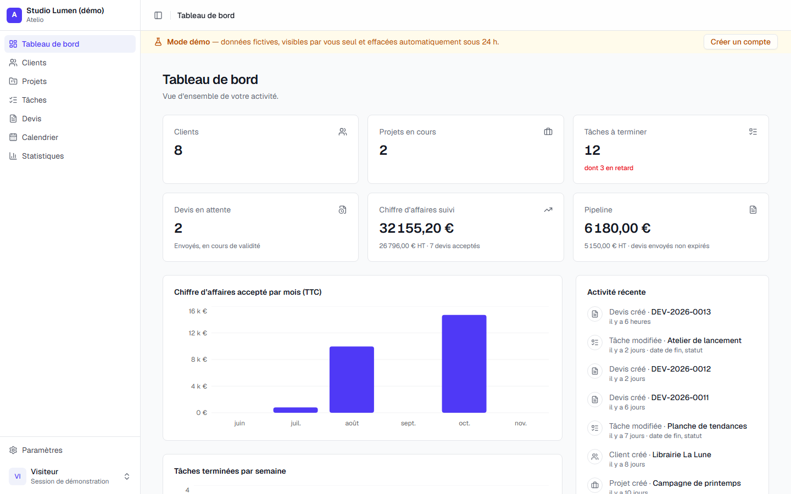
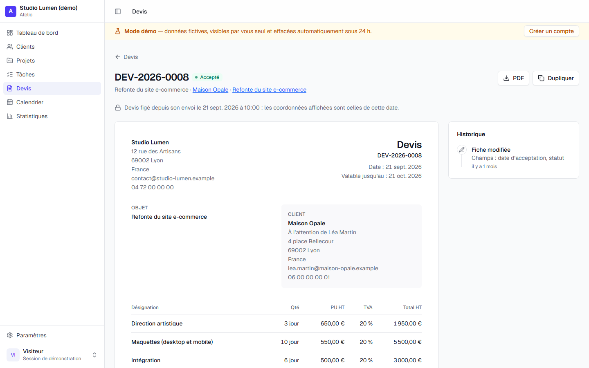
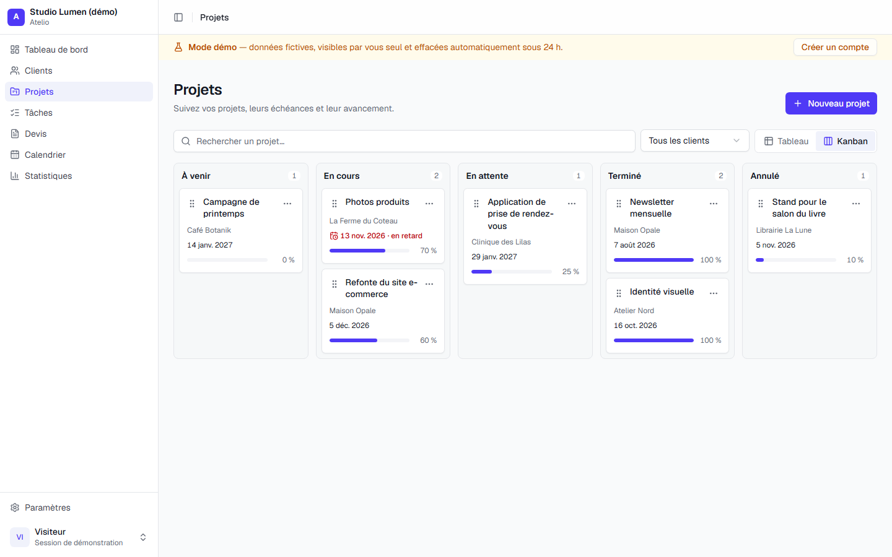
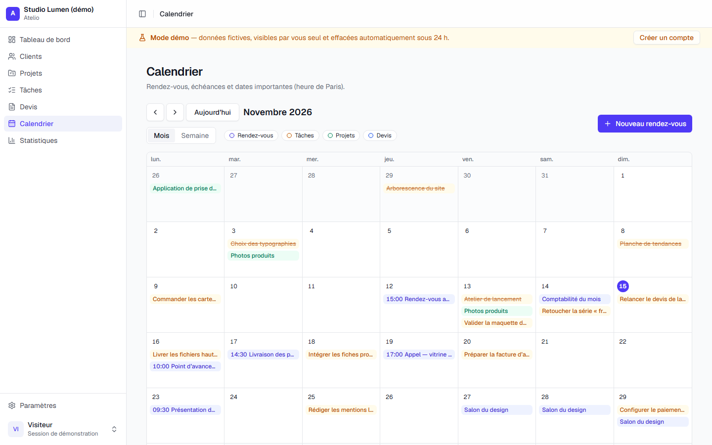
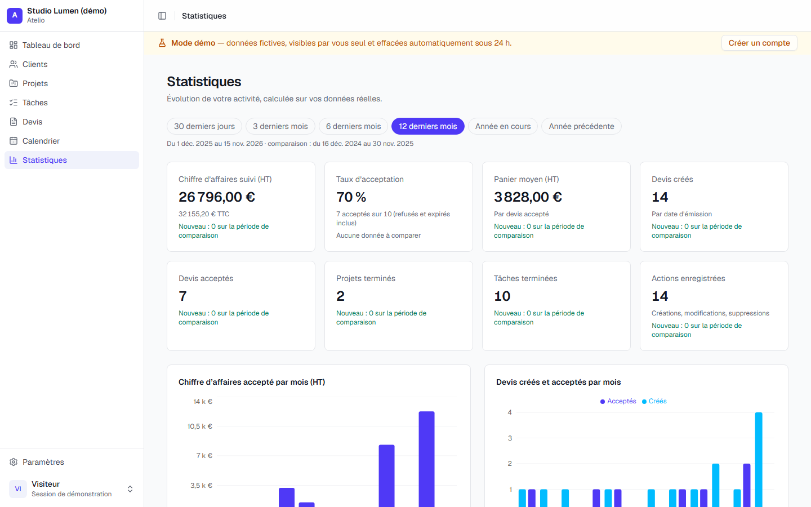
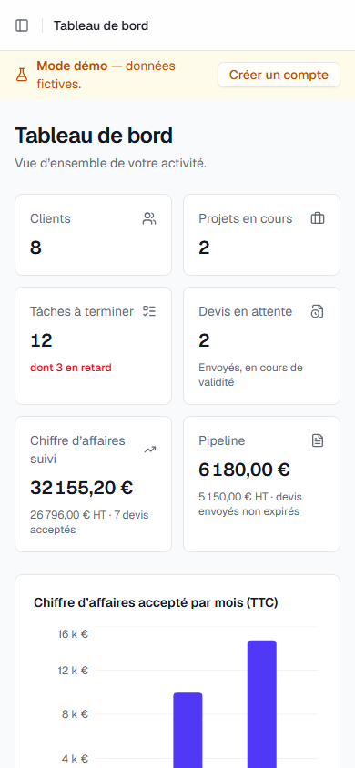
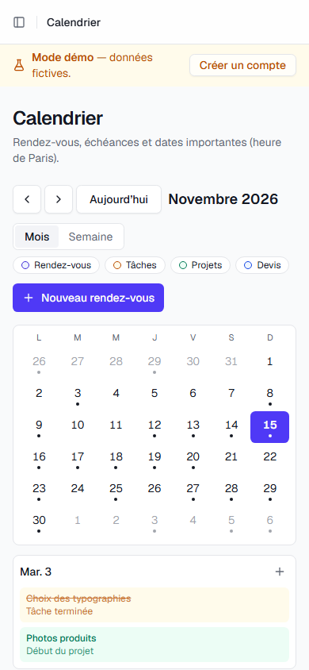
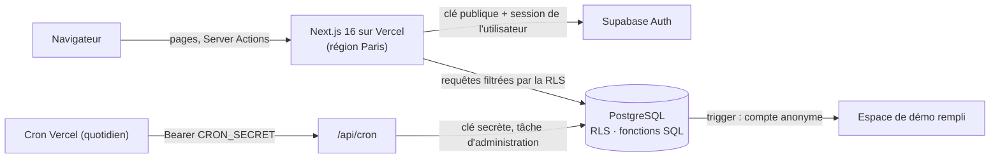

<div align="center">

# Atelio

**Gestion d'activité pour indépendants, freelances, TPE et agences.**
Clients, projets, tâches, devis PDF, calendrier et statistiques — dans une seule application, en français.

### [🌐 Voir le site](https://atelio-inoe.vercel.app) · [✨ Essayer la démo](https://atelio-inoe.vercel.app) (un clic, sans inscription)




</div>

## Sommaire

- [Le projet](#le-projet)
- [Essayer en un clic](#essayer-en-un-clic)
- [Fonctionnalités](#fonctionnalités)
- [Captures d'écran](#captures-décran)
- [Points techniques](#points-techniques)
- [Stack](#stack)
- [Architecture](#architecture)
- [Lancer le projet en local](#lancer-le-projet-en-local)
- [Tests](#tests)
- [Structure du dépôt](#structure-du-dépôt)
- [Documentation](#documentation)

## Le projet

Atelio est une application SaaS complète, conçue comme un **vrai produit** : base de données réelle, sécurité au niveau des lignes, calculs d'argent garantis par la base, génération de PDF, déploiement en production et démonstration accessible à tous.

Un utilisateur crée un compte et obtient son **espace de travail**, isolé des autres. Il y gère ses clients, ses projets (tableau ou Kanban), ses tâches, ses devis (avec PDF), ses rendez-vous, et suit son activité sur un tableau de bord et des statistiques.

## Essayer en un clic

Sur [atelio-inoe.vercel.app](https://atelio-inoe.vercel.app), le bouton **« Essayer la démo »** ouvre en une demi-seconde un **espace privé déjà rempli** : 8 clients, 7 projets, 22 tâches, 14 devis sur 12 mois, des rendez-vous… Les données sont fictives, visibles par vous seul, et supprimées automatiquement au bout de 24 h. Toutes les fonctions sont utilisables.

## Fonctionnalités

| Module | Ce qu'il permet |
|---|---|
| **Tableau de bord** | Indicateurs réels (clients, projets en cours, tâches en retard, devis en attente, CA suivi, pipeline), graphiques, activité récente |
| **Clients (CRM)** | Fiches entreprise / particulier, recherche, filtres, historique, projets et devis du client |
| **Projets** | Vue tableau et **Kanban** (glisser-déposer souris, tactile et clavier), budget, avancement, échéances |
| **Tâches** | Ajout rapide, priorités, échéances, retards, filtres, annulation de la complétion |
| **Devis** | Éditeur avec totaux HT / TVA / TTC en direct, numérotation `DEV-AAAA-NNNN`, envoi (devis figé), accepté / refusé / expiré, duplication, **PDF** |
| **Calendrier** | Vues mois et semaine, rendez-vous (horaire ou journée entière) et échéances des tâches, projets et devis, heure de Paris |
| **Statistiques** | Périodes au choix comparées à la précédente, taux d'acceptation, panier moyen, graphiques, meilleurs clients |
| **Compte** | Profil, changement de mot de passe, suppression du compte et de toutes ses données |

## Captures d'écran

| Devis (aperçu fidèle au PDF) | Projets en Kanban |
|---|---|
|  |  |

| Calendrier | Statistiques |
|---|---|
|  |  |

<p align="center">
  
  &nbsp;&nbsp;
  
</p>

## Points techniques

**🔒 Sécurité multi-espaces, vérifiée par des tests**
- Chaque donnée porte un `workspace_id` ; la **Row Level Security** PostgreSQL est activée sur toutes les tables, avec des fonctions d'appartenance dans un schéma non exposé.
- Droits d'écriture **colonne par colonne** (impossible, par exemple, de déplacer une donnée vers un autre espace ou de modifier son auteur).
- Les références entre tables utilisent des **clés étrangères composites** `(id, workspace_id)` : un projet ne peut pas pointer vers le client d'un autre espace, même en contournant l'interface.
- **129 tests de sécurité** exécutés contre une vraie base avec plusieurs utilisateurs réels (lecture, écriture, suppression, appels de fonctions, accès anonyme).
- Identité vérifiée côté serveur par `getClaims()`, Server Actions avec validation Zod, en-têtes de sécurité, aucun secret dans le code.

**💶 Des montants justes, garantis par la base**
- Argent stocké en **centimes** (`bigint`), taux de TVA en points de base : aucun nombre flottant.
- Les totaux des devis sont **recalculés par une fonction PostgreSQL** à chaque enregistrement ; le navigateur n'envoie aucun montant. Le même calcul en TypeScript (`BigInt`) sert à l'aperçu en direct, et **les deux sont testés sur les mêmes cas de référence**.
- Numérotation sans doublon même en concurrence ; un devis envoyé est figé (coordonnées copiées) et ne peut plus être modifié.

**🕐 Dates et fuseau horaire**
- Toutes les dates « du jour » sont celles de **Paris**, y compris côté base (tableau de bord, statistiques, retards).
- Conversion heure de Paris ↔ UTC sans dépendance, testée sur les changements d'heure (heure inexistante au printemps, heure ambiguë à l'automne).

**✨ Une démo privée par visiteur**
- « Essayer la démo » ouvre une **session anonyme** Supabase ; un trigger crée alors un espace rempli de données **relatives à la date du jour** (le tableau de bord n'est jamais vide ni daté).
- Aucune clé secrète dans ce parcours ; une tâche planifiée quotidienne (cron Vercel protégé par secret) supprime les démos de plus de 24 h et garde la base active.

**♿ Accessibilité et qualité**
- **WCAG 2.1 AA** vérifié automatiquement (axe-core) sur 20 pages : navigation clavier, lien d'évitement, contrastes, graphiques accompagnés d'un résumé textuel.
- Responsive (ordinateur, tablette, mobile), interface entièrement en français.
- TypeScript strict, ESLint, **393 tests** au total, décisions techniques documentées (38 fiches).

## Stack

| Domaine | Outils |
|---|---|
| Application | **Next.js 16** (App Router, Server Components, Server Actions, Cache Components), **React 19**, **TypeScript 6** strict |
| Interface | **Tailwind CSS 4**, **shadcn/ui** (Radix), lucide-react, Recharts, dnd-kit, sonner |
| Formulaires | React Hook Form + **Zod 4** (mêmes schémas côté client et serveur) |
| Données | **Supabase** : PostgreSQL, Row Level Security, Auth (e-mail / mot de passe, sessions anonymes), fonctions SQL / plpgsql, migrations versionnées |
| Documents | @react-pdf/renderer (PDF des devis générés côté serveur) |
| Dates | date-fns, `Intl` (fuseau Europe/Paris) |
| Tests | **Vitest** (unitaires, sécurité RLS), **Playwright** (E2E, Chromium), axe-core (accessibilité) |
| Hébergement | **Vercel** (région Paris, cron quotidien), **Supabase** (projets séparés développement / production) |

## Architecture



- **Server Components par défaut** ; les composants client ne servent qu'à l'interactivité (éditeur de devis, Kanban, graphiques, panneaux).
- **Écritures** : Server Action → validation Zod → contrôle de l'espace → Supabase (la RLS reste le dernier rempart).
- **Organisation par domaine** : `src/features/<module>/` (`actions.ts`, `queries.ts`, `schemas.ts`, `components/`…).
- **Base** : 12 migrations SQL versionnées ; les opérations sensibles (devis, statistiques, suppression de compte, démo) sont des fonctions PostgreSQL.

## Lancer le projet en local

**Prérequis** : Node.js 20.9 ou plus récent, npm, et un projet [Supabase](https://supabase.com) (le plan gratuit suffit ; Docker n'est pas nécessaire).

```bash
git clone https://github.com/memirkocak/Atelio.git
cd Atelio
npm install
```

1. **Variables d'environnement** : copiez `.env.example` en `.env.local` et renseignez l'URL du projet Supabase, la clé publique (*publishable*), la clé secrète et un `CRON_SECRET` (les explications sont dans le fichier).
2. **Base de données** : connectez la CLI Supabase à votre projet, puis appliquez les migrations :

   ```bash
   npx supabase login
   npx supabase link --project-ref <référence-du-projet>
   npm run db:push
   ```

3. **Configuration de l'authentification** (connexion anonyme pour la démo, règles de mot de passe) : relisez puis appliquez `supabase/config.toml` :

   ```bash
   npx supabase config diff
   npx supabase config push
   ```

4. **Démarrage** :

   ```bash
   npm run dev
   ```

   L'application est disponible sur http://localhost:3000.

## Tests

| Commande | Contenu |
|---|---|
| `npm run typecheck` | Types générés par Next.js + `tsc --noEmit` |
| `npm run lint` | ESLint |
| `npm test` | **163 tests unitaires** (calculs, dates et fuseau, schémas, périodes…) |
| `npm run test:rls` | **129 tests de sécurité** contre la base de développement (deux utilisateurs réels et plus) |
| `npm run test:e2e` | **101 tests de bout en bout** Playwright, dont l'accessibilité (démarre le serveur automatiquement) |

Les tests RLS et E2E utilisent le projet Supabase configuré dans `.env.local` et suppriment les comptes qu'ils créent.

## Structure du dépôt

```text
src/
  app/                 Routes (interface en français : /w/[espace]/clients, /connexion…)
  features/<module>/   Domaines : clients, projets, tâches, devis, calendrier, statistiques, démo…
  components/          Coquille de l'application, composants partagés et shadcn/ui
  lib/                 Supabase, authentification, argent, dates, sécurité du cron
supabase/
  migrations/          Schéma, RLS, fonctions SQL (12 migrations)
  config.toml          Configuration de l'authentification (dev et production)
tests/
  unit/  rls/  e2e/    Tests unitaires, de sécurité et de bout en bout
docs/                  Cahier des charges, architecture, décisions techniques, avancement
```

## Documentation

- [Cahier des charges](docs/cahier-des-charges.md) — le besoin fonctionnel
- [Architecture](docs/architecture.md) — architecture technique et schéma de données
- [Décisions techniques](docs/decisions-techniques.md) — 38 décisions argumentées (ADR)
- [Feuille de route](docs/roadmap.md) et [avancement](docs/progress.md) — phases et vérifications réalisées

---

<div align="center">

Projet réalisé par **[memirkocak](https://github.com/memirkocak)** · [atelio-inoe.vercel.app](https://atelio-inoe.vercel.app)

</div>
